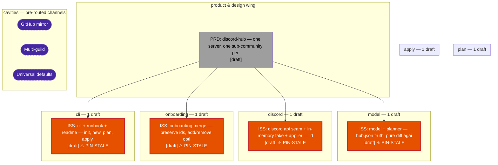

<!-- GENERATED by `scripts/mural map` — the living blueprint projection; do not hand-edit -->
# Mural map — the living blueprint

At a glance: 5 draft — geometry from walls (borders.md), paint from receipts.

